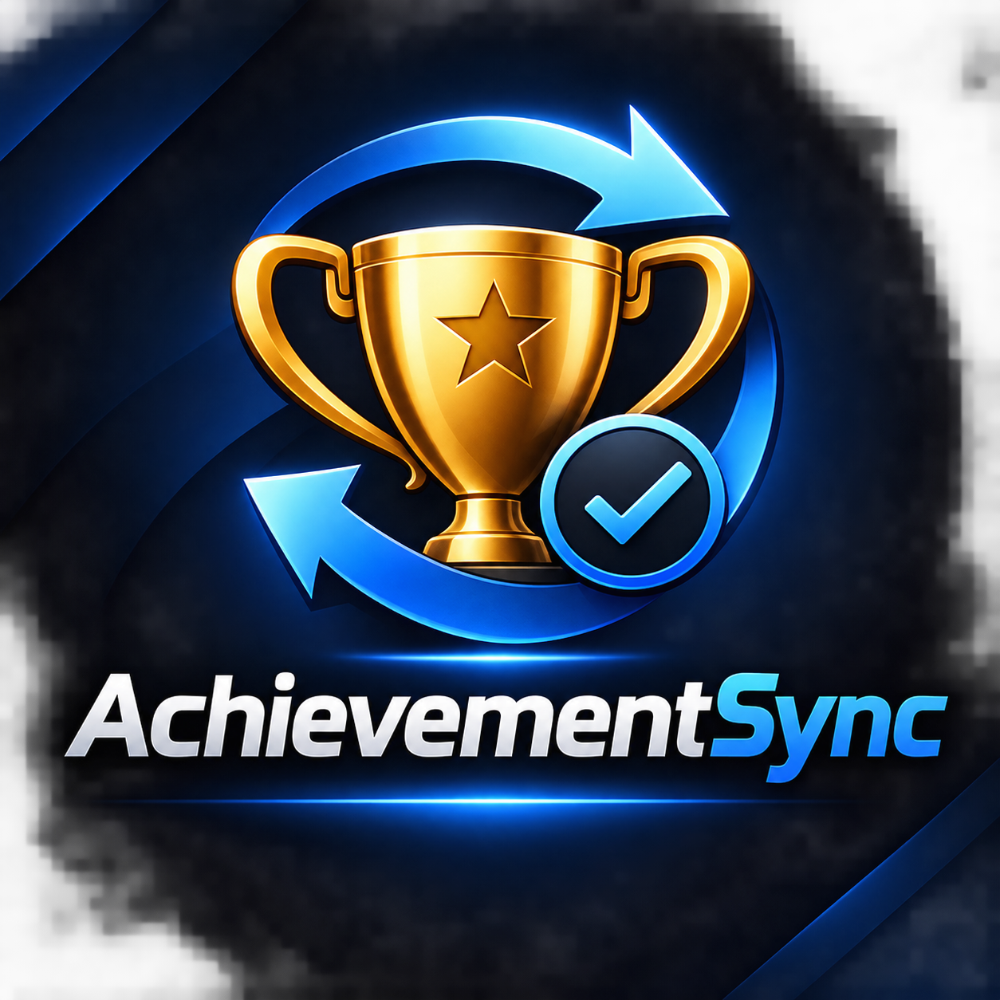

# AchievementSync

<p align="center">
  
</p>

<p align="center">
  <strong>Track, unlock, back up, and showcase your PC &amp; console game achievements — all from one portable Windows app.</strong>
</p>

<p align="center">
  
  
  
  
</p>

---

**AchievementSync** discovers your local achievement files across emulators and game launchers, pops up customizable unlock toasts and playtime banners, backs up your game saves, and syncs your Steam AppID progress directly to your own public **Achievement Viewer** web hub.

> **Start here first!** Before syncing to GitHub, follow **[Roschach96’s Achievement Viewer guide](https://github.com/Roschach96/achievement-viewer)** to fork and create your own public web hub (see [Step 1](#1-create-your-achievement-viewer-hub-required-for-sync)). AchievementSync uploads your progress to that hub — it does not host the website for you.

---

## ✨ Features

- **Unified Game Library** — Automatically discovers local achievement profiles at startup, shows unlock counts and completion percentages, and lets you search, filter, sort, and inspect every game's full achievement list (including descriptions, hidden states, and unlock timestamps).
- **Live File Monitoring** — Watches discovered achievement files and configured platform folders in real time and refreshes automatically when progress or saves change.
- **Multi-Platform Support** — Built-in adapters for **Steam**, **Xbox / Xbox PC**, **Games for Windows Live**, **Xbox 360**, **PlayStation**, **GOG**, **Epic Games**, **Ubisoft Connect**, and **RetroAchievements** (via API + manual platform scan).
- **Built-in Achievement Enabler** — Guided setup powered by **[Roschach96/Achievement-Enabler](https://github.com/Roschach96/Achievement-Enabler)** concepts and payloads: press **Detect** to auto-find the game folder, executable, and AppID/Game ID, optionally generate fresh Steam schemas (with 2FA Steam login stored securely in Windows Credential Manager), preview the exact file plan, and apply with automatic `.bak`/`.BAK` backups.
- **Customizable Unlock Toasts & Trophy Grades** — Shows sleek unlock popups with dynamic color matching, PlayStation-style **Bronze / Silver / Gold / Platinum** trophy headers, 7 screen-position presets + X/Y offsets, built-in chimes or your own `.wav` sound with volume slider, and **auto-detection of the monitor your game is running on**.
- **Playtime Tracking & Session Banners** — Tracks game sessions automatically and displays start/end banners with locally cached **SteamDB screenshots** (falling back to **Steam Store** screenshots when SteamDB has none).
- **GitHub Achievement Sync** — Sign in via GitHub Device-Flow OAuth or Personal Access Token (stored in Windows Credential Manager), inspect a full JSON diff preview, and push numeric Steam AppID `achievements.json` files to your hub. Includes optional **auto-sync after unlock**.
- **Save Backup & Restore** — Preview, upload, and restore game save files via GitHub with automatic user-profile path sanitization (`%APPDATA%` / `%USERPROFILE%`, so your Windows username is never exposed), plus optional **auto-backup after playtime ends**.
- **Offline Ready & Handheld Friendly** — Caches covers, achievement catalogs, icons, and screenshots under `%LOCALAPPDATA%\AchievementSync\metadata\<AppID>\` so everything works offline. Includes **Handheld PC Mode (Compact UI)** for 720p/800p devices like **Steam Deck** and **ROG Ally**, **Start with Windows (tray mode)**, and **built-in SHA-256 verified updates** via GitHub Releases.

---

## 🚀 Quick Start

### 1. Create your Achievement Viewer hub (Required for Sync)

AchievementSync pushes your progress to your personal fork of **[Roschach96/achievement-viewer](https://github.com/Roschach96/achievement-viewer)**. Follow Roschach96's setup guide there:

1. Open **[Roschach96/achievement-viewer](https://github.com/Roschach96/achievement-viewer)** and click **Fork** to copy it to your GitHub account.
2. In your fork, go to **Settings → Pages**, choose **Deploy from a branch**, select `main` and `/ (root)`, then click **Save**.
3. Create a branch named `user` (the website runs from `main`; AchievementSync pushes your achievement data to `user`).
4. Once GitHub Pages finishes deploying, your hub will be live at `https://<your-username>.github.io/achievement-viewer/`.

Want to see how it looks? Check out Roschach96's live hub: **[https://roschach96.github.io/achievement-viewer/](https://roschach96.github.io/achievement-viewer/)**.

### 2. Download and run AchievementSync

1. Download `AchievementSync.exe` (or extract the Windows x64 ZIP) from the **[Releases](https://github.com/pozpo/AchievementSync/releases/latest)** page.
2. Put `AchievementSync.exe` in its own folder (for example `C:\Games\AchievementSync\`) and double-click to launch.
3. No extra installation or separate `.NET` runtime is needed — everything is bundled in the single portable `.exe`.

### 3. Scan your games and folders

- Open **Settings** to toggle built-in achievement locations or add custom folders.
- Open **Platforms** to configure local platform roots (or enter your RetroAchievements username & API key) and click **Scan platform**.
- Non-Steam platform snapshots are stored locally; GitHub sync exports numeric Steam AppID progress.

### 4. Connect GitHub in Sync activity

1. Go to **Sync activity** and sign in with **Sign in with OAuth** or a classic Personal Access Token (`public_repo` scope).
2. Enter your GitHub **Owner**, **Repository** (your `achievement-viewer` fork), and **Branch** (`user`).
3. Click **Build preview** to inspect every file before pushing, then click **Push reviewed changes**.

> [!NOTE]
> Your `achievement-viewer` repository and synced progress/save files are public if your repo is public. Always review the preview before pushing.

### 5. Use Achievement Enabler (Only for games that need an emulator/adapter)

> [!IMPORTANT]
> **Windows Security Exclusions Required for Achievement Enabler**  
> If you want to use **Achievement Enabler**, add these folders to **Windows Security → Virus & threat protection → Manage settings → Exclusions → Add or remove exclusions → Folder** so Windows Defender does not quarantine emulator DLLs, loaders, or generated schemas:
>
> ```text
> C:\Games\
> D:\Games\
> %LOCALAPPDATA%\AchievementSync
> ```
>
> *(Exclusions reduce Defender scanning for everything inside those folders — only add them if you trust every file placed there, or add a narrower folder for a specific game.)*

1. Open **Achievement Enabler**.
2. *(Optional for Steam schema generation)* Sign in with a throwaway Steam account to save a refresh token in Windows Credential Manager.
3. Choose your game folder or `.exe` and press **Detect**.
4. Pick the right **Target emulator** (see the guide below), click **Generate plan**, review every file operation, and click **Apply plan**.

---

## 🎯 Target Emulator Choices (Which One Should You Pick?)

Always run **Detect** first. These options match different game engines, DRM wrappers, and store SDKs — pick the one that matches the game you are setting up, and review the generated plan before applying:

| Target Emulator Option | When to pick it | What it does |
|---|---|---|
| **Steam (Goldberg `steam_api` emulator + generated catalog)** | **Default choice for most Steam games.** Pick this when the game has `steam_api.dll` or `steam_api64.dll` and works with standard API replacement. | Backs up & replaces `steam_api.dll` / `steam_api64.dll` with Goldberg's emulator and writes `steam_settings/` + generated achievement catalog & icons. |
| **Steam ColdLoader + Regular Emulator** | Pick this for **64-bit Steam games** that need a `version.dll` proxy + ColdLoader hook alongside Goldberg (e.g. games where replacing `steam_api64.dll` alone isn't enough). **x64 only.** | Installs `version.dll` proxy, `coldloader.dll`, `coldloader.ini`, `steamclient64.dll`, and `GameOverlayRenderer64.dll` beside the `.exe`, while also replacing `steam_api64.dll`/`steam_api.dll` with Goldberg + `steam_settings/`. |
| **Steam ColdClient (standalone launcher + generated catalog)** | Pick this when you prefer **not to overwrite the game's original `steam_api` DLLs**, or when a game needs a standalone loader / optional **SteamStub** helper injection. | Creates a `_ColdClient` folder with `ColdClientLoader.ini`, `steamclient_loader`, and generated catalog, plus a **Launch ColdClient.bat** launcher (SteamStub helpers are optional and off by default). |
| **Ubisoft Connect R2 emulator** | Pick this for newer Ubisoft games that ship `upc_r2_loader.dll`, `upc_r2_loader64.dll`, `uplay_r2_loader.dll`, or `uplay_r2_loader64.dll`. | Backs up and replaces the R2 loader DLL and writes the R2 config and achievement schema. |
| **Ubisoft Connect R1 emulator** | Pick this for older Ubisoft games that ship `upc_r1_loader*.dll`, `upc_r1.dll`, `uplay_r1_loader*.dll`, or `UbisoftGameLauncher64_Load.dll`. | Backs up and replaces the R1 loader DLL and writes the R1 config. |
| **Epic Games (Nemirtingas emulator)** | Pick this for Epic Games Store titles using `EOSSDK-Win64-Shipping.dll` / `EOSSDK-Win32-Shipping.dll` or `.egstore` manifests. | Detects the Epic namespace (locally or via `egdata.app`), sets up Nemirtingas EOS emulator files, and writes `nepice_settings\NemirtingasEpicEmu.json` + achievement data. |
| **GOG (UniverseLAN)** | Pick this for GOG builds that ship `Galaxy.dll` / `Galaxy64.dll` or `goggame-*.info`. | Verifies Galaxy SDK compatibility, configures UniverseLAN (`Achievements.ini` + server/launcher script), and replaces the matching `Galaxy*.dll` only when a compatible build is confirmed. |
| **EA / Origin emulator** | Pick this for EA App / Origin games with `__Installer\installerdata.xml` or `installerdata.xml`. | Places `anadius` DLLs and `anadius.cfg` beside the game `.exe`, resolves catalog metadata, and safely patches/unwraps compatible PE executables (backing up the original to `.BAK`). |

---

## 🛠️ Build From Source

**Requirements:** Windows x64 and the [.NET 10 SDK](https://dotnet.microsoft.com/download/dotnet/10.0).

```powershell
dotnet restore AchievementSync.sln
dotnet build AchievementSync.sln --configuration Release
dotnet test tests/AchievementSync.SmokeTests/AchievementSync.SmokeTests.csproj --configuration Release
```

To publish the self-contained Windows x64 app as one executable (no runtime installation or script sidecars required):

```powershell
dotnet publish src/AchievementSync.Desktop/AchievementSync.Desktop.csproj `
  --configuration Release `
  --runtime win-x64 `
  --self-contained true `
  -p:PublishSingleFile=true `
  -p:IncludeNativeLibrariesForSelfExtract=true `
  -p:DebugType=embedded `
  -o output\win-x64
```

The publish directory contains `AchievementSync.exe` only. The app does not need a separate .NET runtime, Python installation, or script sidecars to start.

---

## 🙏 Credits & Special Thanks

A massive thank you to **[Roschach96](https://github.com/Roschach96)** for creating both foundational projects that make AchievementSync possible:

- **[Achievement Viewer Hub](https://roschach96.github.io/achievement-viewer/)** ([GitHub](https://github.com/Roschach96/achievement-viewer)) — The achievement showcase hub that AchievementSync syncs with. Follow Roschach96's repository guide to fork and host your own hub page.
- **[Achievement-Enabler](https://github.com/Roschach96/Achievement-Enabler)** — The open-source emulator adapter project used and integrated as the foundation for AchievementSync's Achievement Enabler.

AchievementSync also bundles or integrates third-party open-source tools and emulator payloads (including Goldberg / GBE Fork, ColdClient, ColdLoader, `generate_emu_config`, Nemirtingas Epic Emu, UniverseLAN, and anadius EA/Origin tools). See [THIRD-PARTY-NOTICES.md](THIRD-PARTY-NOTICES.md) and the notice files beside the bundled resources for full attributions and upstream licenses.

---

## 📄 License

Original AchievementSync source code is open source under **GNU GPL-3.0-or-later**. See [LICENSE.md](LICENSE.md).  
Bundled third-party components and emulator payloads remain under their own respective licenses (see [THIRD-PARTY-NOTICES.md](THIRD-PARTY-NOTICES.md)).
