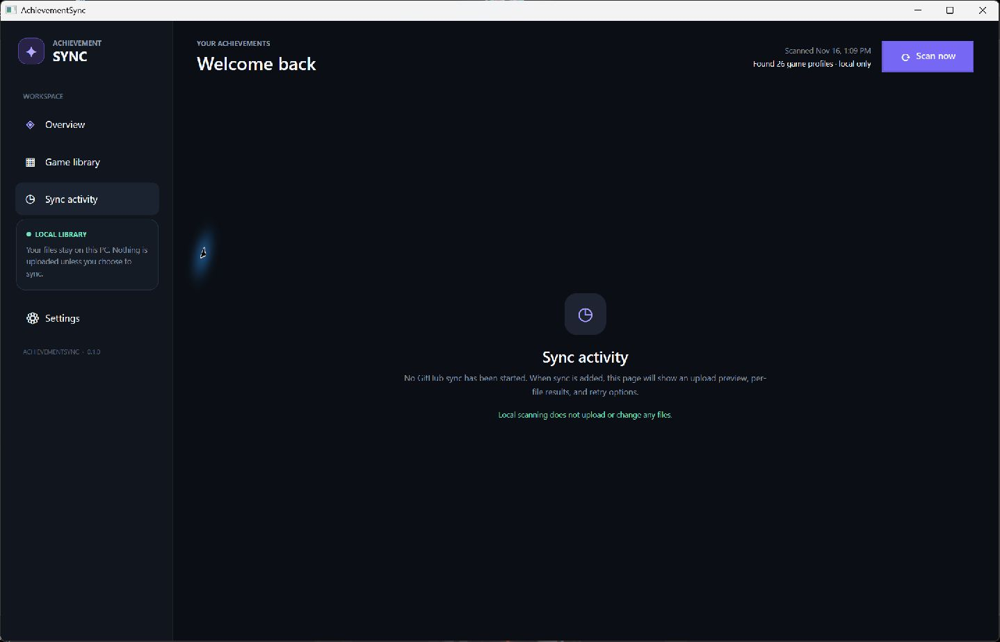

# AchievementSync

<p align="center">
  
</p>

<p align="center">
  <strong>Your games, achievements, and save backups — tracked, unlocked, and synced.</strong>
</p>

<p align="center">
  
  
  
  
</p>

---

## Overview

**AchievementSync** is a modern, high-performance Windows desktop application designed to track, organize, and back up game achievements and save files across your entire local game library. 

Featuring native Windows UI performance, a built-in schema generator, an achievement enabler with zero external app dependencies, and encrypted GitHub synchronization, AchievementSync brings console-grade achievement tracking to your PC.

<p align="center">
  
</p>

---

## Key Features

### Unified Game Library
- **Automatic Multi-Platform Discovery**: Seamlessly indexes Steam, Goldberg, ColdClient, Ubisoft Connect, Epic Games, GOG, and EA emulator save/achievement profiles.
- **Deduplication & Catalog Enrichment**: Automatically groups profiles by numeric AppID, downloads official cover art and achievement icons, and tracks completion percentages.
- **Accurate Playtime Monitoring**: Tracks active game sessions using native Windows process monitoring with zero battery or CPU overhead.

### Built-In Achievement Enabler & Internal Generator
- **Zero Third-Party Downloads**: Generate Steam schemas, ColdClient configurations, and achievement databases directly inside AchievementSync.
- **Secure Windows Credential Storage**: Sign in to Steam once; your session and refresh token are stored in Windows Credential Manager.
- **Safe Plan-and-Apply Workflow**: Preview every file copy, write, and directory change before applying. Original files are protected with `.achievementsync-backup`.

### GitHub Synchronization & Save Backup Subsystem
- **OAuth Device Flow**: Connect securely via GitHub Device Flow without ever typing your personal access token into the app.
- **Preview Before Push**: Inspect pretty-printed JSON changes side-by-side. Nothing is uploaded without your review.
- **Sanitized Save Backups**: Save files are backed up strictly to their AppID folder (`AppID/<id>/save/`), with system path tokens (`%APPDATA%`, `%USERPROFILE%`) to keep your local username private.
- **Auto-Sync on Gameplay Unlocks**: Automatically sync newly unlocked achievements directly to your viewer fork in the background without intrusive popups.

### Custom Toast Notifications
- **Smart Unlock Toasts**: Displays custom toast notifications only on confirmed locked-to-unlocked transitions.
- **Placement & Audio Customization**: Choose screen corner placement (Top Center, Top Right, Bottom Right, etc.) and custom sound effects (Steam, Xbox, PlayStation, or custom `.wav`).
- **Start with Windows & System Tray**: Runs silently in the notification area and launches automatically with Windows.

---

## The Intended Enabler Flow

AchievementSync includes a seamless flow to enable achievements for any game:

```
[1. Sign In] -> [2. Select Game] -> [3. Detect AppID] -> [4. Pick Target] -> [5. Generate Plan] -> [6. Review Plan] -> [7. Apply Plan]
```

1. **Sign in to Steam**: Enter your credentials once to securely acquire and store a `refresh_token` in Windows Credential Manager.
2. **Select the game**: Point to the game's root directory or main executable.
3. **Detect AppID**: Enter the numeric Steam AppID or click **Detect** to auto-read `steam_appid.txt` or game files.
4. **Choose target**: Select the appropriate emulator target (Steam ColdClient, Ubisoft R1/R2, Epic Nemirtingas, GOG UniverseLAN, or EA/Origin).
5. **Leave refresh enabled**: Keeps schema and badge artwork up-to-date with the latest official Steam definitions.
6. **Generate & Review Plan**: Inspect every destination path and file operation in the plan preview.
7. **Apply Plan**: Click **Apply plan** to write configurations, generate achievement files, and update your library immediately.

---

## Download & Installation

AchievementSync is distributed as a **portable, single-file Windows executable** with no installer and no external runtimes required.

- **Download**: [Latest GitHub Release](https://github.com/pozpo/AchievementSync/releases/latest)
- **File**: `AchievementSync.exe` (Self-contained binary)
- **Supported OS**: Windows 10 (64-bit) & Windows 11 (64-bit)

### First Launch
1. Download `AchievementSync.exe` to your preferred folder (e.g., `C:\Games\AchievementSync` or Desktop).
2. Run `AchievementSync.exe`.
3. Enable **Start AchievementSync with Windows** in Settings to keep tracking in the tray.

---

## Privacy & Security

- **Local-First Architecture**: Your games, playtime stats, and save files stay on your computer.
- **Zero Telemetry**: No third-party analytics, tracking pixels, or phone-home requests.
- **Safe Authentication**: All sensitive secrets (Steam refresh tokens, GitHub OAuth tokens, platform API keys) are stored in the hardware-backed **Windows Credential Manager**.

---

## License & Intellectual Property

Copyright (c) 2026 Pozo. All rights reserved.

This software is **proprietary freeware**. It is provided free of charge for personal use. Reverse engineering, decompilation, unauthorized modification, or redistribution of modified source code is strictly prohibited without explicit written permission from the copyright owner.

For questions and support, visit [GitHub Repository](https://github.com/pozpo/AchievementSync).
